# "IN PROGRESS" Pharma Database AI

**A local drug-label browser with side-by-side comparisons and MedGemma summaries.**

Drug labels contain detailed evidence, but comparing the same section across products takes time. Pharma Database AI imports DailyMed labels into a local PostgreSQL database, connects them to ingredient and interaction data, and provides a browser for searching, comparing, and reading the results. MedGemma runs locally to summarize retrieved text. The browser keeps the underlying label available alongside the summary.

**Project status** · Portfolio showcase of a local prototype. The screenshots are from earlier working sessions. The local database is currently unavailable, and this repository contains the walkthrough and screenshots. The application source is maintained separately.

[Screenshots](#screenshots) · [Product workflow](#product-workflow) · [Architecture and integrations](#architecture-and-integrations) · [Development and verification](#development-and-verification) · [Current status](#current-status)

## Screenshots

Select an image to open it at full size. The callouts were added to the captured screens to distinguish summaries, label text, and condition matches.

### Label detail and follow-up questions

| Warfarin label and summary | Tacrolimus chat |
| :---: | :---: |
| <a href="screenshots/warfarin-label-and-summary.png">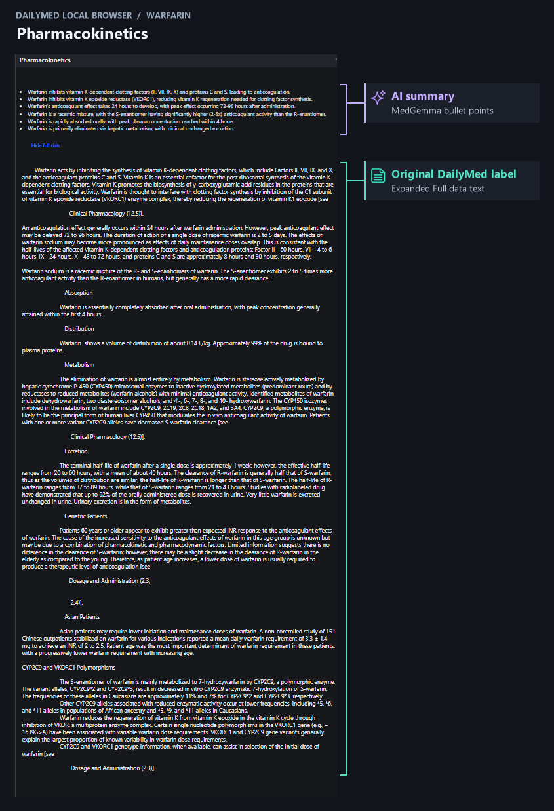</a> | <a href="screenshots/tacrolimus-chat.png">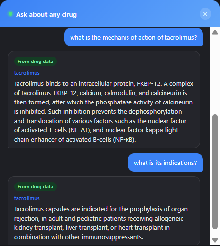</a> |

### Drug comparison

The comparison accepts **2 to 15 drugs**. The table scrolls horizontally as columns are added. This walkthrough uses losartan and captopril. The source label in the losartan column is for a losartan and hydrochlorothiazide product.

| Select drugs and compare | Browse the summary rows |
| :---: | :---: |
| <a href="screenshots/comparison-selection.png">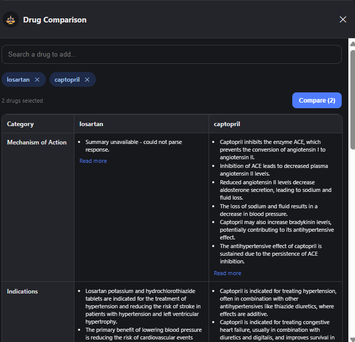</a> | <a href="screenshots/comparison-summary-rows.png">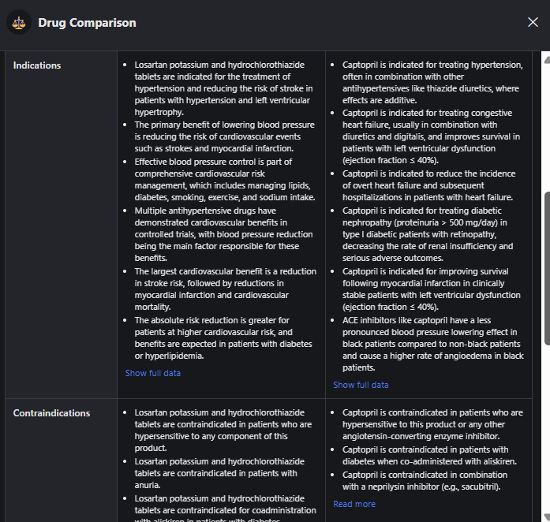</a> |

The first capture shows a summary parsing failure. The label remains available through **Read more**.

**AI summaries alongside the original labels**

<a href="screenshots/drug-comparison.png">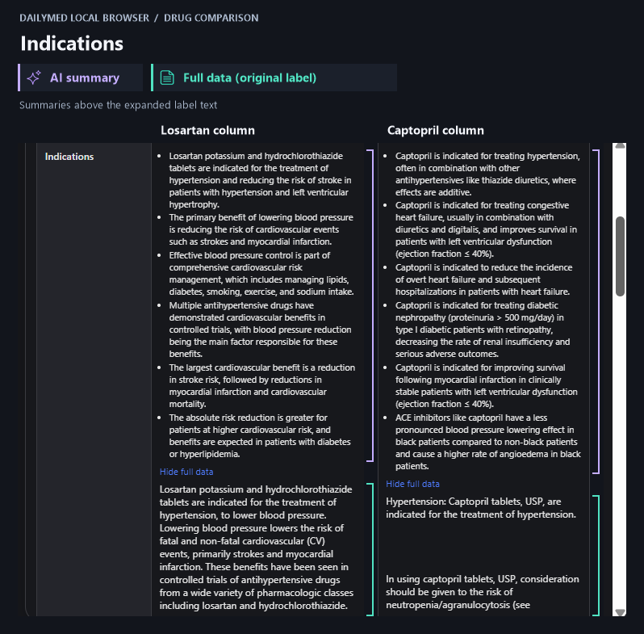</a>

| Expanded label text, continued | Expanded label text, continued | End of the captured label sections |
| :---: | :---: | :---: |
| <a href="screenshots/comparison-label-text-02.png">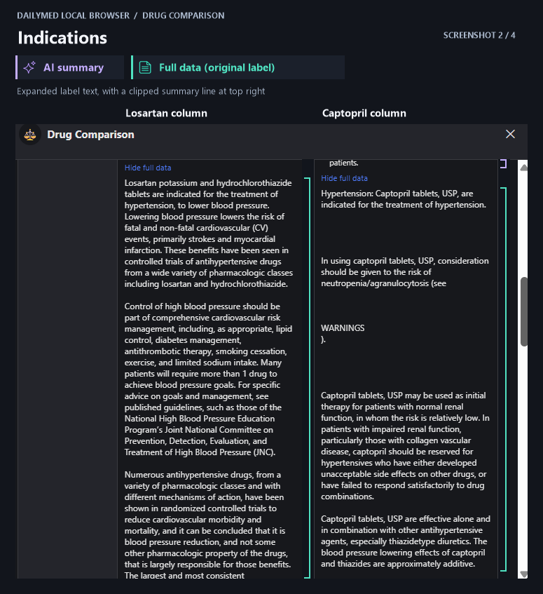</a> | <a href="screenshots/comparison-label-text-03.png">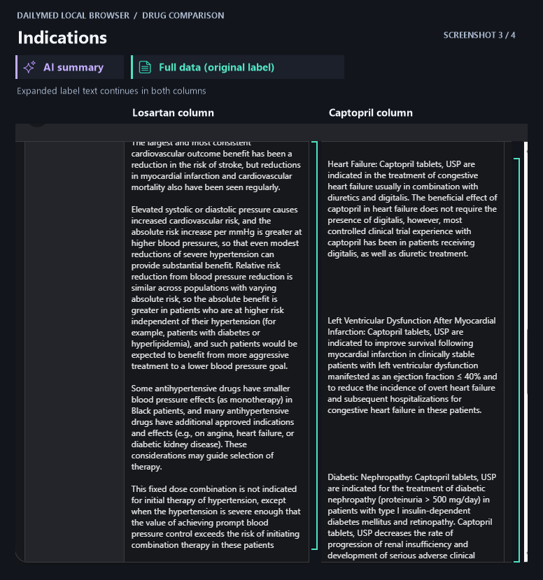</a> | <a href="screenshots/comparison-label-text-04.png">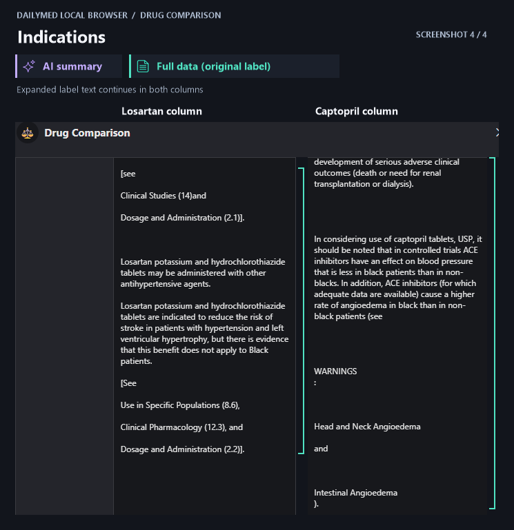</a> |

### Contraindications and cautions

The yellow cards show MedGemma-extracted contraindications and cautions for each compared drug. The badge on each card identifies its category. Documented MED-RT terms appear separately above the cards.

| Losartan | Captopril |
| :---: | :---: |
| <a href="screenshots/comparison-losartan-contraindications.png">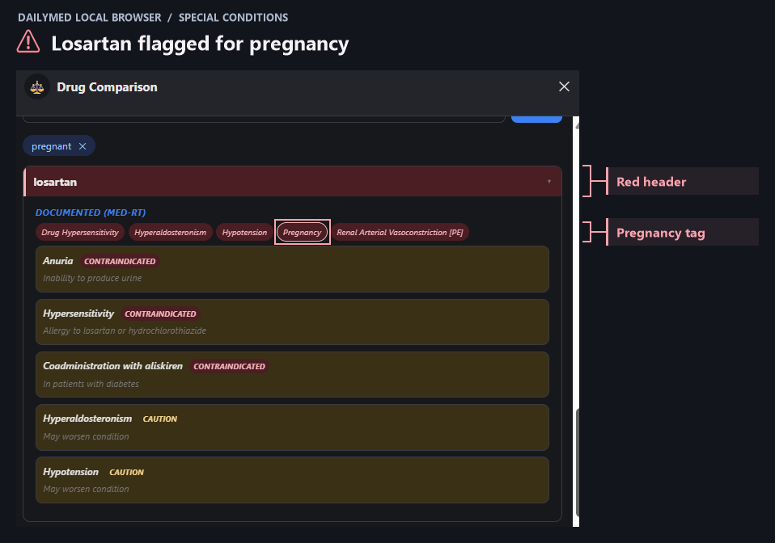</a> | <a href="screenshots/comparison-captopril-contraindications.png">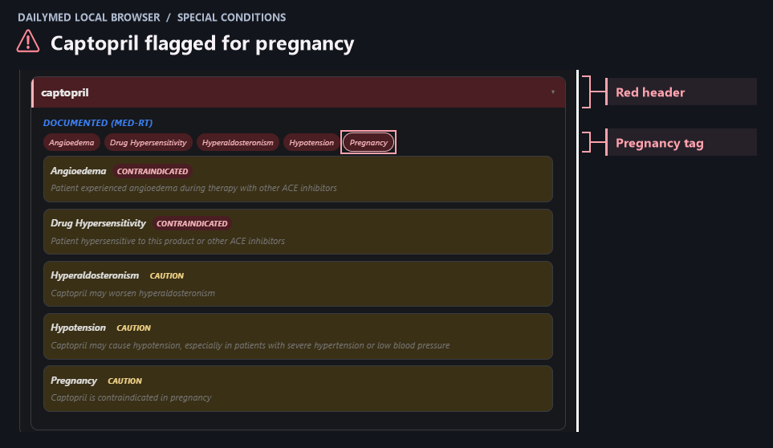</a> |

### Special conditions

<a href="screenshots/pregnancy-condition-match.png">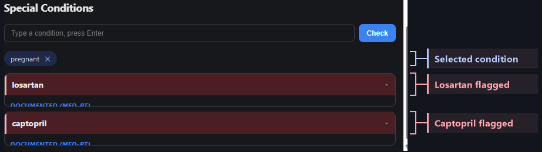</a>

The red headers show that both drugs matched the selected pregnancy condition. The same color is used for every match.

## Product workflow

1. **Find an ingredient.** Search the local RxNorm ingredient vocabulary by name. Open a result to see relevant DailyMed sections, available strengths, structured classifications, and interaction records.
2. **Read or summarize.** Expand the original label text or request a MedGemma summary of a section. The app also supports a drug-wide summary. Comparisons align categories across 2 to 15 selected drugs and keep each column's label text expandable.
3. **Ask a follow-up or check a condition.** Chat uses the selected drug or comparison context and identifies database-derived answers and general-knowledge fallback separately. A condition check matches the entered term against structured and model-extracted entries, then highlights the matching drugs.
4. **Review model suggestions.** A separate local review page lists saved candidates for approval or rejection. The prototype can display approved candidates as marked additions alongside label-derived content.

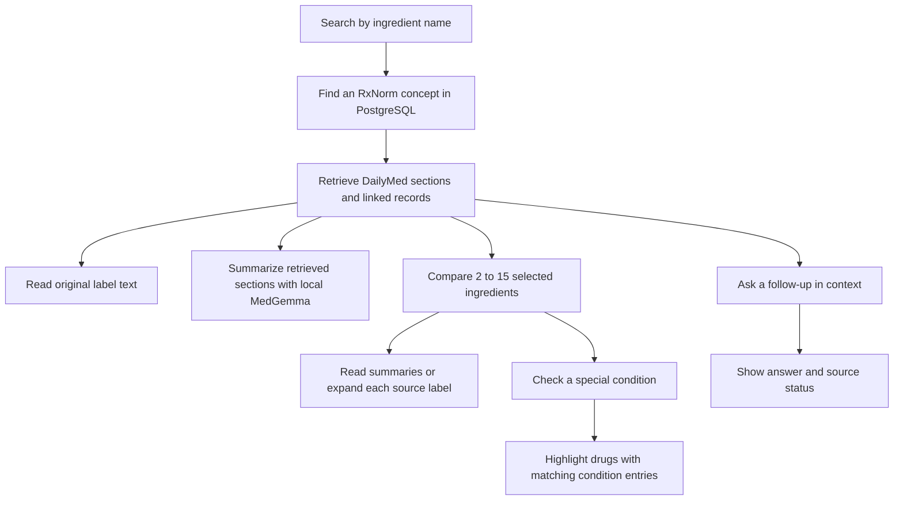

## Architecture and integrations

| Layer | Implementation |
| --- | --- |
| Import and parsing | A Python command-line pipeline discovers SPL XML inside nested DailyMed ZIP archives. lxml parses label documents, product records, ingredient strengths, routes, packages, organizations, and section hierarchies. The pipeline can parse files in worker processes. |
| Storage and updates | SQLAlchemy maps the label data into PostgreSQL. Alembic manages the core label schema. Import batches and file hashes support resume. SPL set IDs and versions distinguish unchanged, superseded, and current records. Monthly deltas preserve labels that are absent from that update. A full-corpus run can mark missing labels inactive. |
| Ingredient linking | RxNorm and OMOP vocabulary tables provide standardized ingredient concepts and relationships to precise ingredients. The browser uses these name variants to find matching active ingredients and current DailyMed labels. |
| Structured enrichment | MED-RT supplies structured classes, effects, and condition associations. PostgreSQL views expose DrugCentral and DDInter interaction records through RxNorm identifiers. The browser also shows interaction text from DailyMed when available. |
| Web application | FastAPI and Uvicorn serve the local JSON API and an HTML, CSS, and JavaScript interface. The same application serves search, drug detail, comparisons, condition checks, chat, and the prediction review page. |
| Local inference | Hugging Face Transformers and PyTorch load Google MedGemma 1.5 4B in the local Python environment. Inference runs one request at a time. Section summaries extract facts first and can run a second pass to condense the result. |

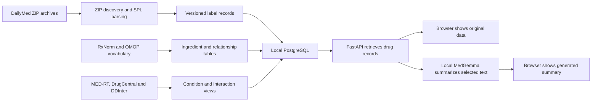

### Engineering decisions

- **Retain label history.** A newer SPL version supersedes the older one. File-level bookkeeping supports restart after interruption and records failures. Keeping the full-corpus and delta modes distinct prevents a routine monthly update from deactivating unrelated labels.
- **Keep labels available during inference.** The browser retrieves original text through database-backed endpoints. A summary is a separate request and the user can expand the underlying text if generation is slow or fails. The local prototype was also exercised in database-only mode during model startup troubleshooting.
- **Make generated content visible as generated.** Summaries and predictions have separate UI labels. The review page records a reviewer decision on saved candidates. In the current implementation, approved additions can enter the text passed to later summaries, so the source boundary still needs tightening.
- **Separate dosing experiments from the main lookup.** Local scripts match antibiotic names to RxNorm concepts and export model-extracted dosing rules for review. The antibiotic lookup module and draft exports are experimental. A fuzzy match needs manual review, and many extraction rows recorded errors.

## Development and verification

| Phase | Work and evidence |
| --- | --- |
| Import foundation | Development validation exercised nested ZIP discovery, malformed XML handling, normalized schema writes, label version changes, and resuming an import against PostgreSQL. The validation notes recorded 18 passing pytest checks for the parser, archive walker, and loader. |
| Dataset import | Local import logs show batches of the human prescription release ran. The importer records inserted, updated, skipped, and failed files, which makes interrupted batches easier to inspect and resume. |
| Browser and integrations | The saved screenshots document label expansion, comparison, chat follow-ups, and condition matching. The private application uses additional vocabulary and interaction database objects beyond the initial label migration. |
| Local model troubleshooting | A Windows model-loading crash was isolated to the weight-loading path. A local launcher switched to a different SafeTensors file reader. In that session, PostgreSQL returned an amoxicillin result and MedGemma returned a six-point indications summary. The prediction review page and its pending-results endpoint also responded. |
| Portfolio handoff | The walkthrough uses archived captures. Source code, database dumps, model weights, and local configuration are kept outside this repository. |

## Current status

The database is currently unavailable, so the walkthrough uses prior captures and verification. Reproducing the full app requires the application checkout, a populated PostgreSQL database with the vocabulary and enrichment objects, and a local model environment. Rebuilding those integrations from an empty database and reviewing generated output for clinical accuracy remain open work.

This is a drug-information prototype for technical demonstration. Generated summaries and matches require verification against the underlying label and appropriate clinical references.

## Data and model references

- [DailyMed](https://dailymed.nlm.nih.gov/dailymed/) and [DailyMed SPL downloads](https://dailymed.nlm.nih.gov/dailymed/spl-resources-all-drug-labels.cfm)
- [RxNorm](https://www.nlm.nih.gov/research/umls/rxnorm/index.html) and [OHDSI Athena](https://athena.ohdsi.org/)
- [MED-RT](https://www.nlm.nih.gov/research/umls/sourcereleasedocs/current/MED-RT/index.html), [DrugCentral](https://drugcentral.org/), and [DDInter](https://ddinter2.scbdd.com/)
- [Google MedGemma 1.5 4B](https://huggingface.co/google/medgemma-1.5-4b-it)
